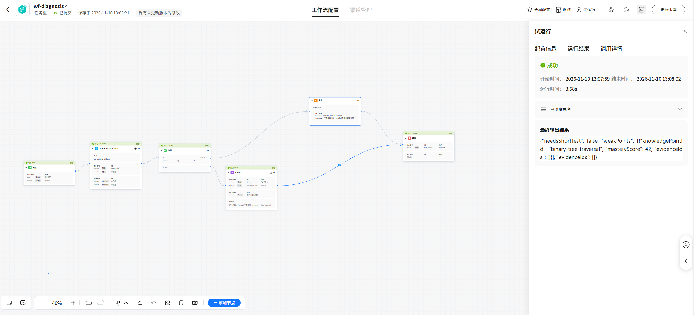
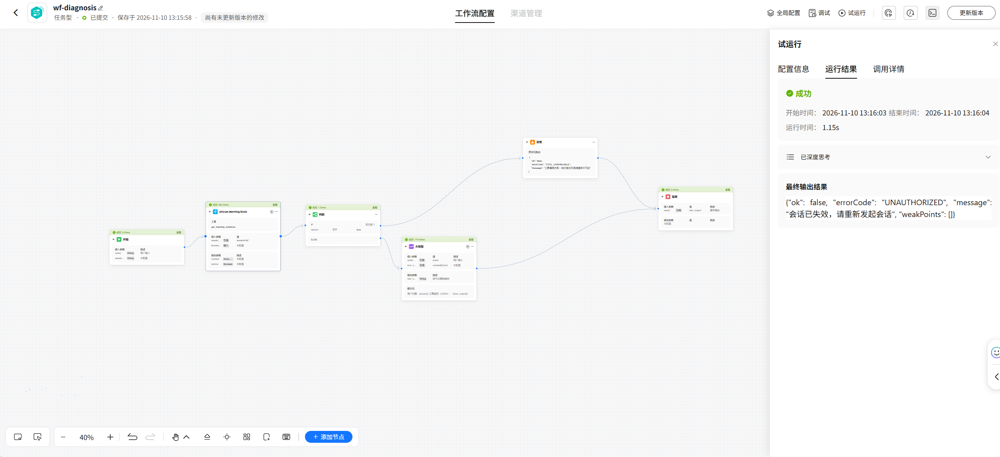

# wf-diagnosis 试运行证据

| 项 | 值 |
|---|---|
| 工作流 | `wf-diagnosis`（学情诊断） |
| 平台 | 华为云 AgentArts · 西南-贵阳一 |
| 工具 | `zhixue-learning-tools / get_learning_evidence`（自建 MCP，公网 HTTPS） |
| 模型 | DeepSeek-V4.1-Flash |
| 数据 | `sessionRef=sref-demo-0000000000000001`，画像含 `binary-tree-traversal`（mastery 42） |

> 两个用例必须成对保存：**D1 证明"能基于证据干活"，D4 证明"身份伪造时不会乱干"**。
> 只放成功截图，评委会认为系统没有边界。

---

## D1 正常路径

**输入**：`query="帮我看看我哪里薄弱"`，`sessionRef=sref-demo-0000000000000001`

**输出**（结束节点 result）：

```json
{"needsShortTest": false,
 "weakPoints": [{"knowledgePointId": "binary-tree-traversal", "masteryScore": 42, "evidenceIds": []}],
 "evidenceIds": []}
```

**结论**

1. 工具节点真实返回 `ok=true`、`hasEvidence=true`，诊断结论来自数据库而非模型臆测。
2. 薄弱点 `binary-tree-traversal` 与画像里的 mastery 42 一致，说明数据贯通。
3. `isError=false` 走 ELSE 分支，大模型拿到了 `content[0].text` 作为证据输入。
4. 全链路 3.58s（含平台到阿里云 MCP 的跨云调用）。



---

## D4 越权路径（伪造 sessionRef）

**输入**：`sessionRef=sref-forged`（服务器不存在该会话）

**输出**：

```json
{"ok": false, "errorCode": "UNAUTHORIZED",
 "message": "会话已失效，请重新发起会话", "weakPoints": []}
```

**结论**

1. 伪造的 `sessionRef` 在 MCP 侧被拒绝，工具返回 `UNAUTHORIZED`，未触发任何数据读取。
2. 模型没有把"鉴权失败"包装成"证据不足"，两者被明确区分。
3. `weakPoints` 为空数组，没有编造薄弱点来"看起来有用"。
4. 失败输出是纯 JSON（含 `errorCode`），前端与评测脚本可直接解析；耗时 1.15s 说明是快速短路，不是超时。



---

## 这两条一起证明了什么

| 维度 | 证据 |
|---|---|
| 证据驱动 | D1 的结论字段与数据库值一一对应 |
| 最小权限 | D4 的伪造引用被 MCP 拒绝，模型侧无从绕过 |
| 诚实降级 | 失败时输出 `ok:false`，不伪装成功、不编造内容 |
| 链路真实 | 两次运行的工具节点耗时（509ms / 182ms）可区分"真调用"与"假数据" |

## 复现步骤

1. 服务器种演示数据（`sessionRef=sref-demo-0000000000000001`），`curl /healthz` 确认 `tools=11`
2. 平台工作流 `wf-diagnosis` → 试运行，填上表输入
3. D1 用真实 sessionRef；D4 把它改成 `sref-forged`
4. 期望输出与本文一致；若 D4 返回 `ok:true`，说明越权防线失守，必须排查
